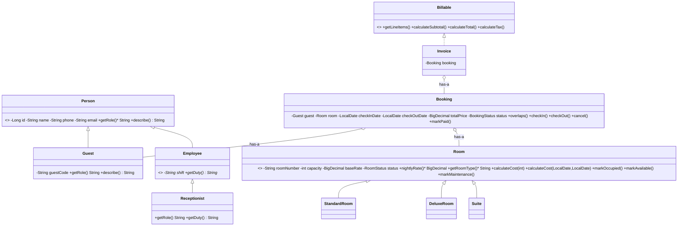

# HOTELIER – Viva guide

## 1. Class diagram

If your editor cannot render Mermaid, paste the block into https://mermaid.live.

## 2. Role of each important class

| Class | Role |
|---|---|
| `Person` | Abstract parent: id, name, phone, email, abstract `getRole()` |
| `Guest` | A person who books rooms; has a unique guest ID like `G-1001` |
| `Employee` / `Receptionist` | Staff hierarchy (3 levels with Person). Shown on dashboard "Front desk" |
| `Room` | Abstract room: number, capacity, base rate, status, pricing contract |
| `StandardRoom`, `DeluxeRoom`, `Suite` | Override `nightlyRate()` with different pricing |
| `Booking` | Links a guest and a room for dates; owns the status rules (state machine) |
| `Billable`, `Invoice` | Interface + implementation that calculate subtotal, 12% GST and total |
| `BookingValidator` | Pure rules: dates and capacity |
| `BookingService` | Orchestrates booking: validate → lock room → check overlap → save. Transactional |
| `RoomService`, `GuestService`, `BillingService`, `HotelService` | Room search/edit, guest CRUD, invoice generation, dashboard numbers |
| `InvoiceExporter` | File handling with try/catch/finally |
| `GlobalExceptionHandler` | Converts Java exceptions to JSON errors the UI can show |
| `*Repository` | Interfaces for database access (Spring Data JPA) |
| `*Controller` | REST endpoints; only translate HTTP ↔ Java |

## 3. Dry run: creating a booking (request → database → response)

1. **React** `NewBookingModal.submit()` validates the form, then calls `api.createBooking()` (`frontend/src/api.ts`) → `POST /api/bookings` with JSON `{guestId, roomId, checkInDate, checkOutDate, numberOfGuests}`.
2. **`BookingController.create()`** receives the JSON as a `BookingRequest` record and calls the service. No business logic here.
3. **`BookingService.createBooking()`** (`@Transactional`) starts a database transaction, then:
   1. Checks ids are present.
   2. `BookingValidator.validateDates()` – not in the past, check-out after check-in, max 30 nights → else `InvalidDatesException`.
   3. `GuestRepository.findById()` → else `ResourceNotFoundException`.
   4. `RoomRepository.findByIdForUpdate()` – **locks the room row** so two simultaneous bookings cannot both pass the overlap check.
   5. Rejects maintenance rooms (`RoomUnavailableException`).
   6. `BookingValidator.validateGuestCount()` – guests ≤ capacity.
   7. Loads the room's active bookings via `BookingRepository.findByRoomAndStatuses()`; for each, `Booking.overlaps()` → if true, `RoomUnavailableException`.
   8. `new Booking(guest, room, in, out, n)` – constructor chaining with `this(...)`; calls `room.nightlyRate()` (**runtime polymorphism**: Standard/Deluxe/Suite each compute differently) and `room.calculateCost(in, out)` (**overloading**, which calls `calculateCost(int)`).
   9. `bookingRepository.save()` → SQL `INSERT` into `bookings`.
4. Transaction commits (or **rolls back** if any exception was thrown).
5. `BookingResponse.from(booking)` builds the JSON (`201 Created`).
6. **React** shows a success toast and opens the booking detail page. On error, `GlobalExceptionHandler` returns `{status, error, message}` and React shows the message in a red toast.

## 4. Live demo script (about 5 minutes)

1. Open the **Dashboard** – point out numbers come from the database (10 rooms, 1 occupied, front-desk staff).
2. **Rooms** – filter by *Suite*; show that the Suite price is base × 1.40 (polymorphism). Add room `105` (Standard) to show create.
3. **Guests** – add a guest "Demo Student"; show the generated guest ID.
4. **Bookings → New booking** – choose the guest, today → +2 nights, pick a room, show the price preview, confirm. Show the confirmation page.
5. **Overlap protection** – open *New booking* in **two browser tabs**, choose the same room and dates in both. Confirm in tab 1 (succeeds). Confirm in tab 2 – the Java server rejects it with "Room ... is already booked from ... to ...". (Normally the room list already hides booked rooms; this shows the server rule itself.) Also point out that choosing check-out before check-in is blocked in the form and again by `BookingValidator`.
6. **Check in** → show the room becomes *Occupied* on the Rooms page and dashboard. Try **Cancel** – rejected (cannot cancel after check-in).
7. **Check out** → room *Available* again. **Mark as paid** → **View invoice** → show room rate, nights, 12% GST, total → **Print**.
8. **Refresh** the browser – all data persists.
9. Open the Java code: `Room` → `Suite` (overriding), `Booking` (state machine), `Billable` / `Invoice`, `exception/` package.

## 5. Viva questions and short answers

1. **What is a class and an object?** A class is a blueprint (`Room`); an object is one real instance (`new Suite("301", 4, rate)`).
2. **What is encapsulation here?** Fields are `private`; changes go through methods that enforce rules, e.g. `Room.markOccupied()` refuses to occupy a room under maintenance, and `Booking` has no setters.
3. **Why private fields?** So no outside code can put the object into an invalid state.
4. **What is a constructor? Which kinds do you use?** Code that builds a valid object. I use parameterised constructors (with validation), overloaded constructors (`Booking` with/without guest count) and a `protected` no-arg one only for JPA.
5. **What is `this`?** A reference to the current object – `this.name = name`, and `this(name, phone, null)` to call another constructor.
6. **What is `super`?** Reference to the parent: `super(name, phone)` calls the parent constructor, `super.describe()` calls the parent method.
7. **What is method overloading? Example?** Same name, different parameters: `Room.calculateCost(int)` and `calculateCost(LocalDate, LocalDate)`. Decided at compile time.
8. **What is method overriding? Example?** A child redefines a parent method: `Suite.nightlyRate()` overrides `Room.nightlyRate()`. Decided at run time.
9. **Overloading vs overriding?** Overloading: same class, different signatures, compile-time. Overriding: child/parent, same signature, run-time.
10. **What is inheritance? Which type do you use?** A child reuses a parent. Multilevel: `Person → Employee → Receptionist`; hierarchical: `Room → Standard/Deluxe/Suite`.
11. **What is runtime polymorphism? Where?** A parent reference calling a method runs the child's version. `Room room = new Suite(...); room.nightlyRate()` returns base × 1.40. `RoomResponse.from(Room)` works for all room types.
12. **What is an abstract class? Why `Person` and `Room` abstract?** A class that cannot be instantiated and may have abstract methods. A "generic room" or "generic person" is not a real thing in a hotel.
13. **Abstract class vs interface?** Abstract class: shared state + partial behaviour, single inheritance (is-a). Interface: a contract, a class can implement many. `Billable` is a contract for "can produce a bill".
14. **Why is `Billable` an interface?** Anything billable (invoice, a future restaurant bill) can provide the same methods without sharing a parent. It also has a `default` method.
15. **Is-a vs has-a?** `Guest` is-a `Person` (inheritance). `Booking` has-a `Guest` and has-a `Room` (composition) – a booking is not a kind of guest.
16. **Why composition for Booking?** A booking only *uses* a guest and a room. Inheriting from them would make no sense and could not combine both.
17. **What are access modifiers?** `private` (class only), default (package), `protected` (package + subclasses), `public` (everyone). I use `private` fields, `public` methods, `protected` constructors in abstract parents.
18. **How do you handle exceptions?** Custom `BookingException` family thrown from business rules; `GlobalExceptionHandler` converts them to HTTP errors with clear messages.
19. **`throw` vs `throws`?** `throw` actually raises an exception; `throws` in a method signature declares it may raise one.
20. **What does `finally` do? Where used?** Runs always. `InvoiceExporter.export()` closes the file in `finally` even if writing fails.
21. **Checked vs unchecked exceptions? Which are yours?** Checked must be handled/declared (`IOException`). My `HotelException` extends `RuntimeException` (unchecked) so Spring rolls the transaction back automatically.
22. **How do you prevent overlapping bookings?** `Booking.overlaps()`: two stays overlap if each starts before the other ends (check-out day is free). The service checks all active bookings of that room while holding a database lock on the room row inside a transaction.
23. **What does `@Transactional` do?** Runs the method as one unit: all database changes commit together, or all roll back if an exception occurs.
24. **How is the total price calculated?** In Java: `room.calculateCost(checkIn, checkOut)` = nightly rate × nights; stored in the booking. The invoice adds 12% GST using the `Billable` default method.
25. **Why a state machine for booking status?** Valid transitions only: Confirmed → Checked in → Checked out, or Confirmed → Cancelled. `Booking.cancel()` after check-in throws `InvalidStateException`.
26. **What is a REST controller? Why keep it thin?** It maps HTTP to Java methods. Business rules in services/models stay testable and reusable.
27. **What is a Repository?** An interface for database operations; Spring Data creates the implementation.
28. **What is JPA/ORM?** Maps Java classes to tables; `Room`'s inheritance becomes one `rooms` table with a `room_kind` column.
29. **How does the frontend talk to the backend?** `fetch` calls to `/api/...` returning JSON; the base URL comes from `VITE_API_URL`.
30. **What is CORS?** Browser rule blocking a site from calling another domain's API unless the API allows it. Backend allows only the frontend URL (`CORS_ALLOWED_ORIGINS`).

## 6. Limitations and future improvements

- No login/roles – anyone with the URL can use the app (fine for a demo; add Spring Security later).
- Payment is simulated; no real gateway.
- Single hotel, single currency (INR), one flat 12% GST rate.
- Search filters in Java over small lists (fine at this size; use database queries for thousands of rooms).
- Free hosting: the backend sleeps after inactivity, the free database expires after 30 days, and invoice files saved on the server are temporary.
- `ddl-auto=update` creates tables automatically; real projects use migrations (Flyway).
- Not implemented: staff management screens, multi-room bookings, discounts, reports, extra charges, early check-out refunds.
